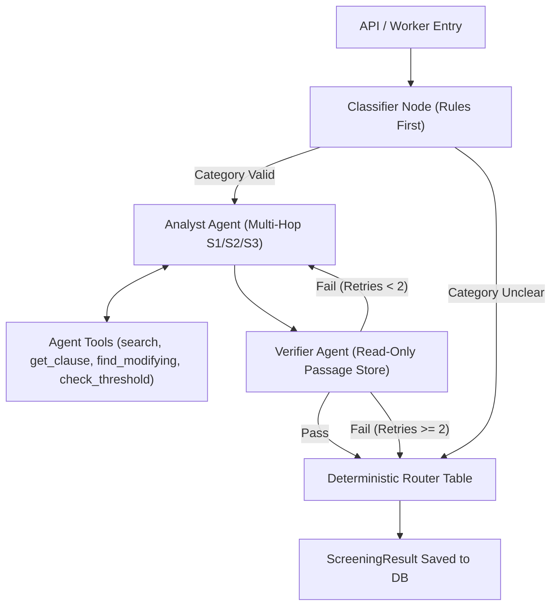

# Agent Topology and System Design

**Author:** Member C (Agents & LLMOps)  
**System:** Bid Compliance Screening Service (UE24AM342AA5)  
**Tender ID:** GEM/2026/B/8034326  

---

## 1. Overview and Topology

The screening workflow is built on a deterministic, fault-tolerant multi-agent architecture orchestrated via LangGraph. The graph isolates specialized roles into distinct nodes with clear boundaries and checkpointer state persistence.

---

## 2. Node Specifications

### 2.1 Classifier Node (`packages/agents/nodes/classifier.py`)
- **Responsibility:** Validates the bidder category (`STARTUP`, `MSE`, `LARGE`, `CONSORTIUM`, `FOREIGN`) using deterministic business rules before invoking LLM logic.
- **Rules:**
  - `STARTUP`: Requires `dpiit_certificate_number`. Checks incorporation date against corpus limit (5 years from incorporation under Startup Action Plan 2016 Annexure 1.A). Startups older than 5 years trigger `category_unclear = True` (Scenario S13).
  - `MSE`: Requires valid `udyam_number` and `mse_class` (`MICRO` or `SMALL`).
  - `CONSORTIUM`: Requires at least 2 members.
- **Short-Circuit:** If `category_unclear` is True, bypasses downstream analyst steps and transitions directly to the Router, resulting in `ESCALATE_TO_HUMAN` with reason `CATEGORY_UNCLEAR`.

### 2.2 Analyst Agent (`packages/agents/agents/analyst.py`)
- **Responsibility:** Evaluates mandatory conditions MC-01 through MC-09 against the validated bid summary.
- **Multi-Hop Retrieval Strategies:**
  - **S1 (Normal Search):** Retrieves core tender clauses for threshold requirements (`HDR.min_turnover`, `HDR.exp_years`, `EMD.detail`).
  - **S2 (Rewritten Query):** Formulates targeted queries combining bidder classification with policy topics (e.g., `"relaxation prior turnover experience STARTUP"` in `CorpusScope.POLICY`).
  - **S3 (Metadata Linking):** Inspects passage metadata (`modifies`, `modified_by`) to discover binding policy circulars (e.g., `DOE_OM_2016_09_20::P2`).
- **Conditional Relaxation Rule:** Under tender terms (`MII.4`, `MII.3`) and DoE OM 2016, relaxation for Startups and MSEs is conditional on meeting quality and technical specifications. Thus, bidders failing numeric thresholds receive status `CONFLICT` (never an automatic `MET`).

### 2.3 Verifier Agent (`packages/agents/agents/verifier.py`)
- **Responsibility:** Acts as an adversarial quality gate with read-only access to the session's retrieved passage store.
- **Verification Invariants:**
  1. Every finding with status `MET`, `UNMET`, or `CONFLICT` must cite at least one passage.
  2. Every cited `clause_id` must resolve to an exact passage in the session store.
  3. Quoted text spans must appear verbatim in the retrieved passage and cannot exceed 40 words.
  4. Summaries must not assert facts ungrounded by the retrieved corpus.
- **Retry Mechanism:** On failure, signals the Analyst to retry with alternative query strategies (up to `MAX_VERIFY_RETRIES=2`). If retries are exhausted, sets `verification_passed = False`, triggering escalation with `VERIFICATION_FAILED`.

### 2.4 Router (`packages/agents/nodes/router.py`)
Deterministic decision table implementing strict priority rules (Section 4.3):
1. Any finding `CONFLICT`, or category unclear $\rightarrow$ `ESCALATE_TO_HUMAN`.
2. Verification failed, guardrail block, budget exhausted, provider down $\rightarrow$ `ESCALATE_TO_HUMAN` with matching reason.
3. Any `UNMET` finding with no applicable relaxation $\rightarrow$ `REJECT_WITH_CITED_CONDITION`.
4. Any `NOT_VERIFIABLE` finding $\rightarrow$ `SEEK_CLARIFICATION`.
5. Otherwise $\rightarrow$ `PASS_TO_TECHNICAL_EVALUATION`.

---

## 3. Resilience and Fault Recovery

- **Checkpointer:** `MemoryCheckpointer` snapshots state after the classifier and analyst steps. If an unhandled exception occurs, the system can reload the checkpoint or transition to `FAILED` with zero risk of emitting an unverified or hallucinated recommendation.
- **Execution Limits:** Configured via environment variables (`MAX_STEPS=12`, `MAX_TOOL_CALLS=15`, `RUN_TIMEOUT_S=60`, `LLM_TIMEOUT_S=20`, `TOOL_TIMEOUT_S=5`).

