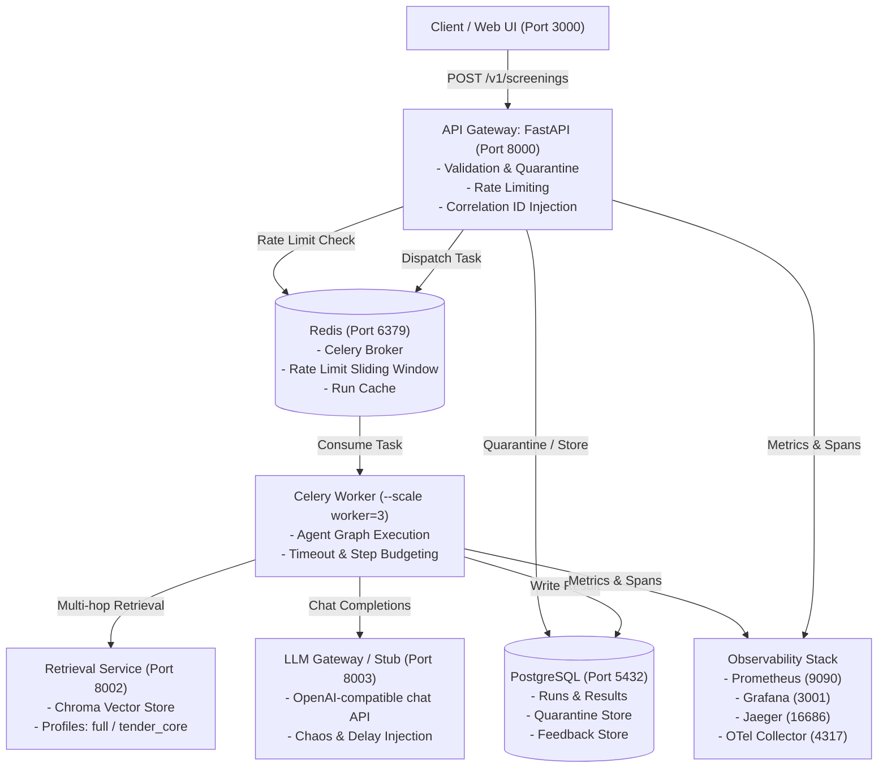

# System Architecture & Topology
**Service:** Public Procurement Bid Compliance Screening Service (Mini Project 06)  
**Author:** Member A (Platform & Reliability)

---

## 1. Service Boundaries and Deployment Diagram



---

## 2. Multi-Agent Reasoning Topology (LangGraph)

The screening worker executes a multi-agent graph with strict verification gates and bounded tool call budgets (§4.2):

```mermaid
flowchart TD
    Start([Task Enqueued]) --> Classifier["Classifier Node\n- Verifies declared category\n- Extracts qualification entities"]
    Classifier -->|Category Unclear| RouterEscalate["Router: ESCALATE_TO_HUMAN\n(CATEGORY_UNCLEAR)"]
    Classifier -->|Category Confirmed| Analyst["Analyst Agent\n- Strategy 1: Direct search_corpus\n- Strategy 2: Query rewritten from retrieved text\n- Strategy 3: get_clause on modifying provisions"]
    
    Analyst <--> Tools["Agent Tools:\n- search_corpus\n- get_clause\n- get_bid_fields\n- find_modifying_provisions\n- check_threshold"]
    
    Analyst --> Verifier{"Verifier Agent\n- Read-only check\n- Every citation in retrieved text?\n- Every claim supported?"}
    
    Verifier -->|Verification Failed\n(Retry < 2)| Analyst
    Verifier -->|Verification Failed\n(Retries Exhausted)| RouterEscalate2["Router: ESCALATE_TO_HUMAN\n(VERIFICATION_FAILED)"]
    Verifier -->|Verification Passed| RouterTable["Deterministic Router Table (§4.3)"]
    
    RouterTable --> R1["ESCALATE_TO_HUMAN\n(Finding Conflict / Rule Conflict)"]
    RouterTable --> R2["REJECT_WITH_CITED_CONDITION\n(Unmet condition with no relaxation)"]
    RouterTable --> R3["SEEK_CLARIFICATION\n(Missing documentation / unverifiable)"]
    RouterTable --> R4["PASS_TO_TECHNICAL_EVALUATION\n(All mandatory conditions met)"]
```

---

## 3. Asynchronous Execution Lifecycle

1. **Submission:** Caller sends `POST /v1/screenings` with `BidSummary` JSON and client credentials.
2. **Synchronous Validation:** Pydantic schema validation runs in API process. If invalid, the payload is directed to `quarantine` table with HTTP 422; no background task is created.
3. **Queueing:** Valid payload is written to PostgreSQL as `QUEUED` and pushed onto the Redis Celery queue. API responds with `202 Accepted`, `run_id`, and status polling URL.
4. **Execution:** Celery worker pulls the task, marks state `RUNNING`, sets `X-Correlation-ID` in contextvars, and starts the screening pipeline.
5. **Persistence:** Findings, citations, route, and advisory flags are written to `runs` table and marked `COMPLETED`.
6. **Polling & Trace:** Caller queries `GET /v1/screenings/{run_id}` for completed disposition, and `GET /v1/runs/{run_id}/trace` for the complete audit log.
