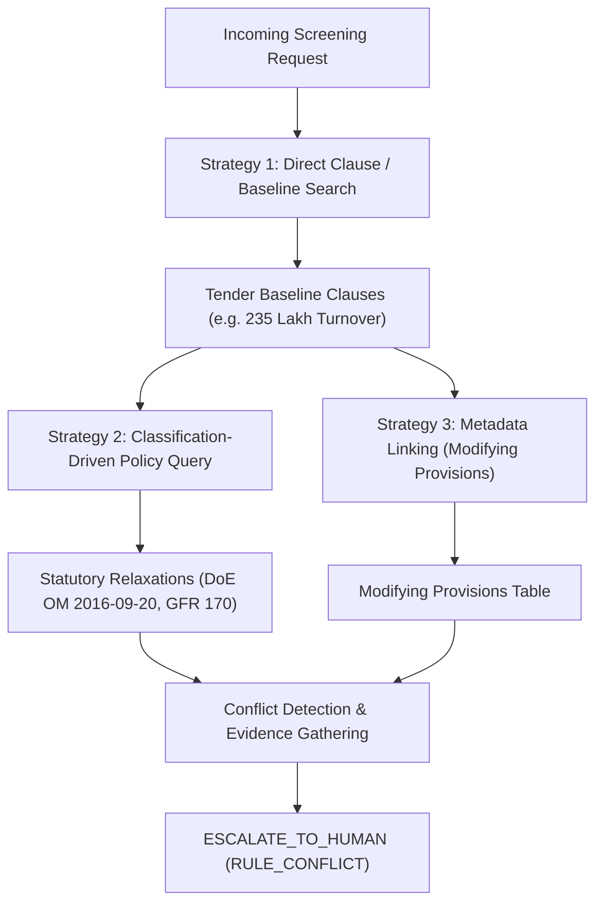

# Corpus, Chunking, and Embedding Strategy

**Author:** Sri Ram V (Knowledge, Ingestion, Retrieval & Safety)  
**System:** Bid Compliance Screening Service (UE24AM342AA5)  
**Target Tender:** GEM/2026/B/8034326 (NIC Onsite Professionals)  
**Reference:** Requirements L1, D2, F4, Section 3, Section 4.1  

---

## 1. Corpus Difficulty & Two-Corpus Conflict Analysis (§3)

The screening corpus presents a fundamental structural conflict between two authoritative document collections:
1. **The Tender Corpus (`corpus/tender corpus/`):**
   - Tender document `GeM-Bidding-9890354.pdf` specifies strict mandatory baseline conditions:
     - **MC-01:** Earnest Money Deposit of INR 1,17,600.
     - **MC-02:** Minimum Average Annual Turnover of INR 235 Lakh across 3 financial years.
     - **MC-03:** 3 Years of past service experience in similar category.
     - **MC-04:** Similar completed service contracts (3@40%, 2@50%, or 1@80% of estimate).
     - **MC-05:** >= 20% manpower on payroll for at least one year.
     - **MC-06:** Document completeness.
     - **MC-08:** Service office in consignee state (Delhi / NCR).
   - Read alone, any bidder below 235 Lakh turnover would be immediately marked **REJECT**.

2. **The Policy Corpus (`corpus/policy corpus/`):**
   - **DoE OM F.20/2/2014-PPD (Pt.) dated 20.09.2016:** Central government mandate relaxing prior turnover and prior experience for all recognized Startups (whether MSE or not), subject to technical capability.
   - **DoE OM dated 25.07.2016 & 27.07.2017:** Relaxations for Micro and Small Enterprises (MSEs).
   - **General Financial Rules (GFR) 2017 Rule 170(i):** Statutory exemption from Bid Security (EMD) for DPIIT-recognized Startups and MSEs.
   - **GFR 2017 Rule 144(xi):** National security restrictions on bidders sharing land borders with India.

**The Core Difficulty:** The tender document and statutory policy orders **do not cross-reference each other**. A single-pass dense vector retrieval querying only the tender requirements would conclude the startup is non-compliant and recommend rejection. The dual-corpus architecture must intentionally bridge this gap through structured multi-hop retrieval.

---

## 2. Ingestion & Chunking Architecture (`ingestion/`)

### 2.1 Chunking Strategy
- **Semantic Clause-Level Granularity:** Rather than arbitrary fixed-token windows (which break cross-sentence legal conditions), documents are chunked into self-contained semantic clauses identified by canonical IDs (e.g., `GEM_BID_8034326::HDR.min_turnover`, `DOE_OM_2016_09_20::P2`).
- **Metadata Enrichment:** Every chunk is annotated with:
  - `corpus`: Partition identifier (`TENDER` or `POLICY`).
  - `topics`: Categorical tags (`turnover`, `experience`, `emd`, `relaxation`, `land_border`).
  - `applies_to`: Target bidder categories (`STARTUP`, `MSE`, `LARGE`, `CONSORTIUM`, `FOREIGN`, `ALL`).
  - `legal_status`: `IN_FORCE` vs `SUPERSEDED`.
  - `modifies`: Pointers to tender conditions that this statutory policy rule alters or overrides (e.g. `DOE_OM_2016_09_20` modifies `["MC-02", "MC-03"]`).

### 2.2 Idempotent CLI Pipeline (`ingestion/pipeline.py`)
- Run with `python -m ingestion.pipeline`.
- Reads PDFs, generates deterministic chunk identifiers using SHA-256 hashes of `doc_id::clause_id::prefix`, and persists an indexed catalog to `corpus/corpus_index.json`.
- Records pipeline metadata: `generated_at`, `total_chunks`, `ingestion_duration_seconds`, and data freshness timestamp.

---

## 3. Multi-Hop Retrieval Engine (`services/retrieval/`)

To solve the difficult case (§4.1), the retrieval engine provides three access strategies:

### 3.1 Retrieval Microservice Endpoints (:8002)
- `GET /health`: Health and index status.
- `POST /retrieve`: Filtered multi-criteria search (by query, corpus scope, bidder category, and topics).
- `POST /clause`: Exact retrieval of full clause text and citation source by canonical ID.
- `POST /modifying`: Identification of statutory provisions that modify or relax a given mandatory condition.
