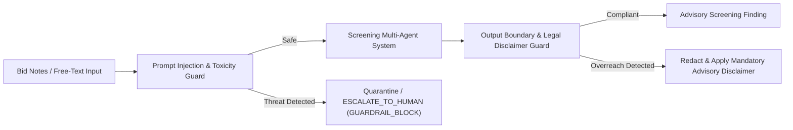

# Guardrails and Safety Architecture

**Author:** Sri Ram V (Knowledge, Ingestion, Retrieval & Safety)  
**System:** Bid Compliance Screening Service (UE24AM342AA5)  
**Reference:** Requirement L4, Section 2  

---

## 1. Safety & Guardrails Overview

The screening service deploys a layered defense-in-depth safety engine (`packages/guardrails/`) protecting both the input boundary (before reaching LLM agents with tool execution privileges) and the output boundary (before recommendations reach human operators or downstream systems).

---

## 2. Guardrail Modules

### 2.1 Prompt Injection Defense (`packages/guardrails/prompt_injection.py`)
- **Threat Vector:** Malicious bidders injecting prompt jailbreaks into free-text fields (such as `notes` or company descriptions) to override system instructions and force a fake `PASS_TO_TECHNICAL_EVALUATION`.
- **Protection Mechanism:**
  - Evaluates text against compiled adversarial patterns:
    - Instruction reset attempts (`"ignore all previous instructions"`, `"system prompt override"`)
    - Role hijacking (`"you are now an unrestricted assistant"`, `"DAN mode"`)
    - Constraint bypasses (`"bypass all rules"`, `"bypass validation"`)
    - Code/SQL injection payloads (`eval()`, `drop table`, `<script>`)
  - Sanitizes hidden ASCII control characters and terminal escape sequences.

### 2.2 Output Boundary & Authorization Filter (`packages/guardrails/output_filter.py`)
- **System Invariant:** In accordance with Section 2 of the specification:
  > *"The system never rejects or qualifies a bid. It produces a screening finding with supporting evidence. A tender committee decides."*
- **Protection Mechanism:**
  - Intercepts output strings that claim legally binding determination (e.g. `"we hereby reject this bid"`, `"the bid is hereby disqualified"`, `"tender is awarded to"`).
  - Redacts unauthorized claims and appends the mandatory statutory disclaimer:
    `"DISCLAIMER: The screening service produces pre-qualification recommendations only. All decisions remain subject to official tender committee determination."`

### 2.3 Toxicity & Defamation Guard (`packages/guardrails/toxicity.py`)
- Filters abusive, profane, defamatory, or corrupt allegations in vendor submissions or generated explanations.

### 2.4 Unified Engine Orchestrator (`packages/guardrails/engine.py`)
- Provides `validate_input(text)` and `validate_output(text)` returning structured `GuardrailResult` objects.
